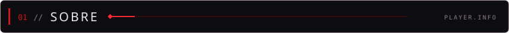
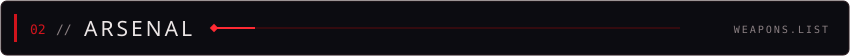
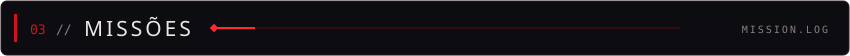
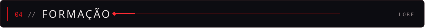
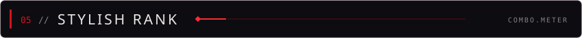
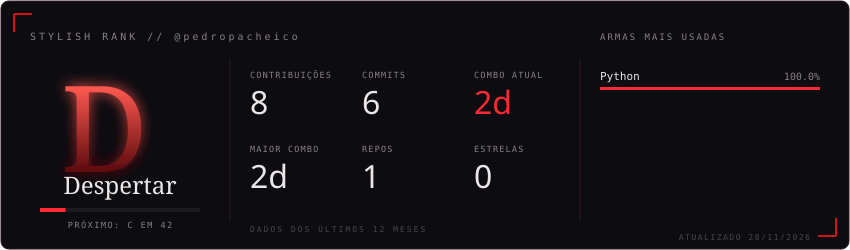
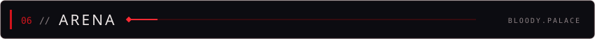
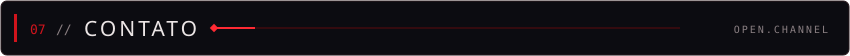

 

<code>>_ transformando café, Python e bugs derrotados em sistemas que funcionam</code>

  

<!-- Para adicionar e-mail, tire o comentário da linha abaixo e troque SEU_EMAIL -->
<!--  -->

 

<table>
<tr><td><b>CLASSE</b></td><td>Estudante de Análise e Desenvolvimento de Sistemas · Dev backend em formação</td></tr>
<tr><td><b>ARMA PRINCIPAL</b></td><td>Python — com Django e Flask</td></tr>
<tr><td><b>OFÍCIO</b></td><td>Sistemas web, APIs e bancos de dados que resolvem problema de gente de verdade</td></tr>
<tr><td><b>GUILDA</b></td><td>Core Team do AWS Student Builder Group FAESA (eventos) · Projeto Gambiarra</td></tr>
<tr><td><b>BASE</b></td><td>Vitória · Espírito Santo · Brasil</td></tr>
<tr><td><b>COMBUSTÍVEL</b></td><td>Café, games e bugs que não morrem no primeiro golpe</td></tr>
</table>

 

  

**◆ BACKEND**
 `Python` `Django` `Flask` `APIs REST` `Java`

**◆ DADOS**
 `SQLite` `MySQL` `Pandas` `Power BI`

**◆ FRONT-END**
 `HTML` `CSS` `JavaScript` `TypeScript` `Angular`

**◆ FERRAMENTAS**
 `Git` `GitHub` `VS Code` `Eclipse`

**◆ EM TREINAMENTO**
 `Django REST Framework` `AWS` `Java POO`

<!-- Quando subir cada projeto, troque o nome pelo link: [SmileCash 2.0](https://github.com/pedropacheico/NOME-DO-REPO) -->
<table>
<tr><th>Missão</th><th>Briefing</th></tr>
<tr><td>◆ <b>SmileCash 2.0</b></td><td>Sistema de gestão financeira feito para um consultório odontológico de verdade. Começou só no front com localStorage e virou Flask + SQLite, com login multiusuário e débito automático.</td></tr>
<tr><td>◆ <b>Carro Robô Fotográfico</b></td><td>Carro controlado remotamente com câmera embarcada para registrar momentos de lazer. Python, Flask e SQLite. Próxima fase: seguir a pessoa e fotografar quando detectar um rosto.</td></tr>
<tr><td>◆ <b>Projeto Gambiarra</b></td><td>Grupo de freelance com colegas de curso. Lidero o front-end e organizamos o código com branches no GitHub.</td></tr>
</table>

**◆ Análise e Desenvolvimento de Sistemas**
 FAESA · em andamento

<b>📜 Experiência e comunidade</b>

 

- **AWS Student Builder Group FAESA** — Core Team, coordenação de eventos
- **Projeto Gambiarra** — líder de front-end em projetos freelance
- **Freelancer** — SmileCash, sistema entregue para cliente real

 
D · C · B · A · S · SS · SSS — o rank sobe conforme as contribuições do ano. Atualizado todo dia.

Cada contribuição, um demônio a menos.

*Backend, Python, estágio, projeto freelance ou uma boa indicação de jogo.*

[LinkedIn](https://www.linkedin.com/in/pedro-henrique-ferreira-a87958329) · [Repositórios](https://github.com/pedropacheico?tab=repositories)

 

Créditos

 
Banners, títulos e Stylish Rank criados para este perfil. Fontes: Pirata One, Oswald e JetBrains Mono (SIL Open Font License). Ícones: <a href="https://skillicons.dev">Skill Icons</a>. Badges: <a href="https://shields.io">Shields.io</a>. Arena: <a href="https://github.com/Platane/snk">Platane/snk</a>.

